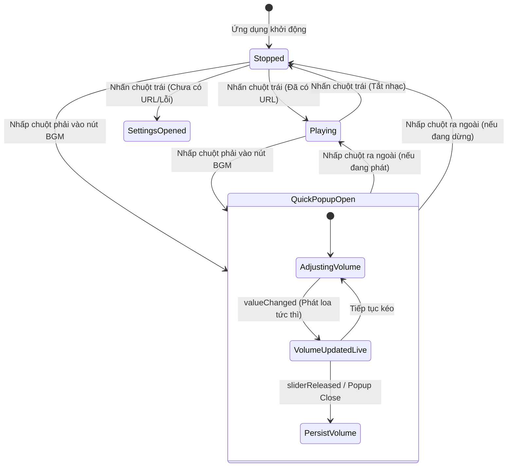

# Data Model: Nâng Cấp Điều Khiển Nhạc Nền

**Feature**: `005-bgm-controls-enhancement`
**Status**: Completed

## 1. Mở Rộng Trạng Thái Thực Thể Domain

### BgmConfig (Đã tồn tại trong `src/domain/models.py`)
Mô hình cấu hình dịch vụ nhạc nền, được duy trì và lưu trữ trong `settings.json`:

```python
@dataclass
class BgmConfig:
    enabled: bool = False
    source: str = "youtube"       # Nguồn phát hợp lệ hiện tại: "youtube"
    source_target: str = ""       # URL hoặc Video ID
    volume: int = 50              # Mức âm lượng: 0 đến 100
    loop: bool = True             # Lặp lại tự động khi hết bài
```

- **Quy tắc ràng buộc (Validation Rules)**:
  - `volume`: Số nguyên trong đoạn $[0, 100]$. Mọi giá trị nhỏ hơn 0 ép về 0, lớn hơn 100 ép về 100.
  - `source`: Chuỗi định danh nguồn phát. Chỉ nguồn `"youtube"` được coi là khả dụng (Active), các nguồn khác (`"spotify"`, `"local"`) ở trạng thái dự phòng (Disabled).

---

## 2. Mô Hình Trạng Thái Hiển Thị (UI State Models)

### BgmDisplayState
Trạng thái hiển thị tức thời của nút BGM trên thanh điều khiển nổi:

| Trường | Kiểu dữ liệu | Mô tả | Giá trị ví dụ |
| :--- | :--- | :--- | :--- |
| `is_playing` | `bool` | Nhạc nền có đang thực sự phát âm thanh hay không | `True` / `False` |
| `button_text` | `str` | Tiêu đề hiển thị trên nút | `"🎵 Bật nhạc"` hoặc `"🔇 Tắt nhạc"` |
| `tooltip` | `str` | Chú thích công cụ khi rê chuột | `"Bật nhạc nền (Chuột phải để chỉnh âm lượng)"` |

### QuickVolumePopupState
Trạng thái của cửa sổ popup chỉnh âm lượng nhanh:

| Trường | Kiểu dữ liệu | Mô tả | Giá trị ví dụ |
| :--- | :--- | :--- | :--- |
| `volume` | `int` | Giá trị âm lượng hiện hành hiển thị trên slider | `0` đến `100` |
| `is_visible` | `bool` | Trạng thái hiển thị của popup nổi | `True` / `False` |
| `anchor_pos` | `QPoint` | Tọa độ điểm neo toàn cục ngay trên nút `btn_bgm` | `QPoint(x, y)` |

---

## 3. Lược Đồ Tương Tác Trạng Thái (State Transition Diagram)



